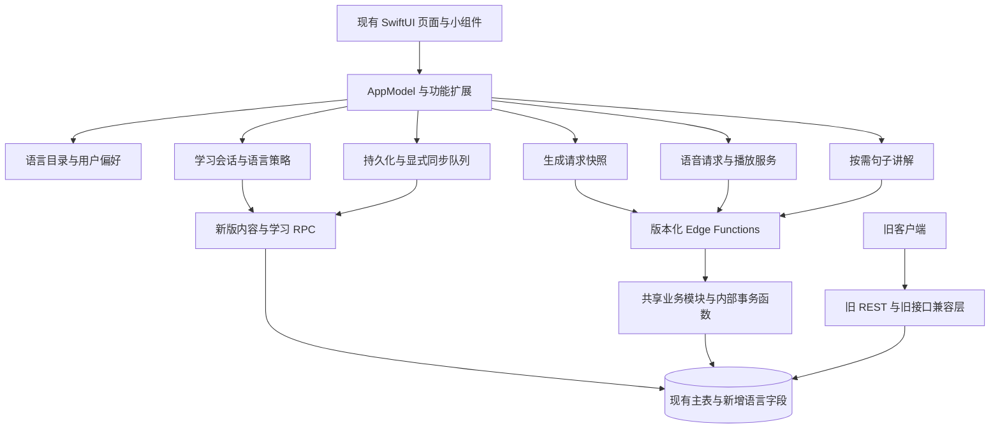

# 三句多语言第一期代码架构设计

日期：2026-10-13

状态：设计稿，尚未实现。本次只编写文档，不修改客户端、后端、数据库迁移或部署配置。

范围依据：[多语言第一期范围](multilingual-phase-one.md)。以下文件名、类型、字段和新版接口名如未在现有代码中出现，均为拟定设计。

范围调整：界面仅支持简体中文和英文；五种翻译／讲解语言、四种学习语言及 10 个学习组合保持不变。

## 1. 架构决策

1. **沿用 AppModel、现有功能服务和数据库主表。** 不重写 App，不建立四套按语言复制的页面、服务或学习记录。
2. **把内容语言与用户当前偏好分开。** 回忆携带生成时的语言；生成请求携带不可变快照；浏览和播放不读取当前偏好来猜句子的语言。
3. **领域模型使用通用文本字段。** 新代码使用 `targetText` / `translationText`；`english` / `chinese` 只留在旧格式适配和数据库兼容投影中。
4. **新版客户端通过版本化 RPC 访问学习内容。** 旧直接 REST 路径只暴露英语原句＋简体中文翻译的数据；新版接口经过账号归属校验后读取全部语言。
5. **语言差异集中到策略模块。** 支持组合、难度、生成提示、分词、日语读音和音色路由有明确归属，不散落在 View 中。
6. **生成、讲解、朗读分别版本化。** 外部契约分版本，内部复用审核、限流、余额事务、账号作用域和播放引擎。
7. **语言内学习队列与跨语言每日额度分开。** 学习记录仍以稳定句子 ID 为身份；语言是筛选条件，不是第二份学习进度。
8. **增量迁移，逐语言开放。** 先完成英语兼容与数据基础，再按西语、日语、法语的顺序验收。

## 2. 当前实现及其约束

| 已有实现 | 代码证据 | 对架构的约束 |
| --- | --- | --- |
| `AppModel` 配合功能扩展组织业务 | `三句/AppModel.swift`、`AppModel+Generation.swift`、`AppModel+Memories.swift` | 保留协调入口，把新增纯规则和数据对象移到独立文件 |
| 原句、翻译固定为英语和中文 | `AppModel.swift`、`SupabaseModels.swift`、`SupabasePayloads.swift` | 客户端、传输模型与持久化格式需一起演进 |
| 直接 REST 读写回忆、收藏、进度和任务 | `SupabaseService.swift` | 不能只增加 `language` 字段或只改 Edge Function |
| 生成请求有稳定请求 ID、任务恢复及原子扣次 | `AppModel+Generation.swift`、`generate-memory-v2/handler.ts`、`repository.ts` | 保留幂等边界，新增参数必须随任务快照保存 |
| 访客回忆分两次写入回忆和句子 | `SupabaseService.createMemoryCopy` | 新版改为一次数据库内容事务，图片上传仍在事务外 |
| 去重按回忆 ID，明确不按相同文本匹配 | `MemoryIdentity.swift` | 继续保留 UUID，不按语言或文本重新生成身份 |
| 偏好同步有账号、revision、pending 保护 | `GenerationPreferenceSync.swift`、`SpeechPreferenceSync.swift` | 扩展现有同步模式，不另建第二个账号状态来源 |
| 讲解语言由页面 locale 推导 | `SentenceDetailView.swift` | 需引入独立讲解偏好，并迁移旧英文界面用户的行为 |
| 填空按空格拆词，英语词表决定挖空 | `SentenceStudyQuestion.swift` | 拆出语言策略，日语不能复用该算法 |
| 语音缓存硬编码模型、四种英语音色和 24 kHz PCM | `SpeechAudioCache.swift`、`SpeechPreferences.swift`、`CloudSpeechClient.swift` | 需要显式语音描述与实际返回格式 |
| 翻一翻熟悉度与填空学习进度独立 | `AlbumFlipHistory.swift`、`AppModel+AlbumFlip.swift` | 不把翻卡、收藏或播放变成一次学习激活 |
| 小组件有自己的英文／中文快照结构 | `MemoryWidgetSnapshotStore.swift`、`三句小组件/三句小组件.swift` | 主 App 与扩展的快照协议同步升级 |

### 2.1 必须纠正的现状认识

范围文档要求“每天最多激活 30 句新内容”。早期 `20260424003000_sentence_study_daily_limit.sql` 有队列预算，但较新的 `20260921000000_use_device_study_time_zone.sql` 已覆盖相关函数，当前队列和记录函数没有完整执行这个上限；本地队列也只是按调用方传入的 limit 截取。

因此，本期需要**落实这项产品要求**，不能声称直接复用已有可靠的全局限制。本文将“新内容”定义为第一次进入正式学习的句子；到期复习和当天再学不消耗新句额度。

仓库还未包含最初所有主表、Storage 和 RLS 的完整建库定义，且项目使用过 migration baseline。本设计是基于工作区代码的方案，不代表已核实线上数据库权限；实施前需获取目标环境只读 schema／策略清单核对。

## 3. 总体分层

View 负责展示和发出意图；AppModel 负责协调状态、账号与任务；领域模块处理语言规则；服务层处理接口和格式适配；数据库负责归属、幂等和事务约束。

## 4. 语言领域与核心类型

### 4.1 标识规范

| 概念 | 首期值 | 用途 |
| --- | --- | --- |
| `LearningLanguage` | `en`、`es`、`ja`、`fr` | 学习内容分类、队列筛选 |
| `SupportLanguage` | `zh-Hans`、`en`、`es`、`ja`、`fr` | 翻译和讲解 |
| `InterfaceLanguage` | `system`、`zh-Hans`、`en` | 仅控制设备界面；不能与 SupportLanguage 共用可选值集合 |
| `TeachingLocale` | `en-US`、`es-419`、`ja-JP`、`fr-FR` | 教学用法约定；不是语音供应商代码 |
| `LearningLevel` | `starter`、`beginner`、`intermediate`、`advanced` | 稳定难度 ID，显示名称本地化 |

`es-419` 是内容用法约定，不能直接假设供应商或系统音色接受它；语音模块另行解析到经过验收的实际 locale。旧难度字符串“启蒙／简单／中等／高级”在兼容适配器中映射，不能继续作为通用领域 ID。

拟新增 `LanguageCatalog` 与 `LanguagePolicy`，集中处理：

- `supportsGeneration(target, support)`：严格对应范围文档的 10 个组合。
- `supportsExplanation(target, support)`：上述组合，以及英语原句使用英文讲解的兼容例外。
- `defaultTeachingLocale(target)`、难度配置、假名能力、可用音色。
- `canGenerate` 与 `canRead` 分离。关闭某语言的新生成，不影响已有内容的读取、收藏、复习或恢复。

建立 `contracts/languages.v1.json` 作为语言代码、教学变体和组合的唯一人工编辑来源。实施时用一个简单脚本生成客户端资源和 Edge 资源；数据库种子随新增 migration 固定版本，契约检查比对三端与原始目录。运行时开放状态由服务端能力接口返回，不由模型或客户端自行决定。

### 4.2 领域类型及责任

| 类型 | 核心数据 | 不变量 |
| --- | --- | --- |
| `LearningSelection` | 标准学习组合，或 `legacyEnglish` 兼容档 | 一次原子切换完整组合，不保存无效的半组合 |
| `GenerationSpec` | 学习语言、翻译语言、教学变体、难度、两组句子格式、目录版本 | 点击生成时固定；之后不读取实时偏好覆盖 |
| `GenerationRequestSnapshot` | owner、账号 revision、请求 ID、访客任务 ID、GenerationSpec、分析图摘要、时间 | 与 pending 恢复记录一起持久化 |
| `MemoryContentContext` | 学习语言、翻译语言、教学变体、内容 schema 版本 | 随回忆保存，不随设置变化 |
| `SentenceContent` | 原句、译文、内容版本、可选 `SentenceLearningMaterial` | 原句和译文独立于展示语言；学习材料不修改正文 |
| `SentenceRecord` | 现有句子 UUID、SentenceContent、展示组、分类、收藏 | 保留稳定 ID 与现有状态 |
| `SentenceContext` | 句子＋所属回忆的语言上下文 | 给播放、讲解、练习传递完整语义，不能只传 String |
| `StudyFilter` | 学习语言、现有 study scope | 是查询条件，不是学习记录主键 |
| `StudySessionContext` | owner revision、固定语言、会话 ID、题目队列、学习日时区 | 会话开始后不受全局语言切换影响 |
| `SpeechRequest` | 文本、语言、教学变体、音色配置 ID／版本、owner | 前台播放、预加载、缓存共同使用 |

语言属性以回忆为数据库权威来源，因为一期一张回忆只有一种学习语言和一种翻译语言。句子队列 DTO 可以展开这些字段，解码后必须校验与所属回忆一致；不能产生两份可独立修改的语言状态。

### 4.3 旧英文界面的兼容例外

旧英文界面用户实际是“生成英语＋中文翻译，但 AI 用英文讲解”。直接迁移成英文讲解→英语学习，会与 10 组合限制冲突。

采用显式 `LearningSelection.legacyEnglish(explanationLanguage)`：目标固定英语、生成翻译固定简体中文，默认讲解按升级前实际界面语言一次性导入。它不作为第 11 个公开学习组合，不在新用户选项中展示。

升级后切换界面语言不再更改这份已导入偏好。用户主动选择标准组合时，整体离开兼容档。历史英语句子仍可通过 `supportsExplanation(en, en)` 使用英文讲解。

## 5. 客户端模块与状态管理

建议按责任增加少量文件，保留现有工程组织方式，不要求引入新的状态框架、依赖注入框架或本地数据库。

| 模块／拟定文件 | 责任 | 现有接入点 |
| --- | --- | --- |
| `LanguageDomain.swift`、`LanguageCatalog.swift` | 语言类型、组合、目录与验证 | 从 AppModel 和页面移出语言分支 |
| `LearningPreferences.swift`、`LearningPreferenceSync.swift` | 组合、各语种难度、同步状态 | 演进 GenerationPreferenceSync |
| `InterfaceLanguageStore.swift` | 设备语言选择、解析后的 bundle 和 locale | L10n、App 根视图、小组件 |
| `GenerationSpec.swift` | 请求快照及旧请求适配 | AppModel+Generation |
| `SentenceContent.swift`、`LegacyContentAdapter.swift` | 通用内容和历史格式边界 | AppModel、SupabaseModels、Persistence |
| `SentenceLearningMaterial.swift`、`StudyQuestionBuilder.swift` | 学习片段、读音、出题 | SentenceStudyQuestion |
| `StudyLanguagePolicy.swift`、`StudyActivationStore.swift` | 语种规则、访客新句激活账本 | AppModel+Memories 的学习部分 |
| `SpeechDescriptor.swift`、`SpeechVoiceCatalog.swift` | 语种与音色描述、缓存身份 | SpeechService、CloudSpeechClient、预加载 |
| `SupabaseService+Content.swift`、`+Learning.swift`、`+LanguagePreferences.swift` | 新版接口 DTO 和映射 | 复用现有请求、认证和重试设施 |

拆分 `SupabaseServicing` 时，仅按本期调用需要抽出小协议；保留现有总协议作为过渡组合，避免一次改动所有测试替身。

### 5.1 三种状态分别管理

- **设备界面状态**：system／手动简体中文或英文，仅存设备及 App Group；系统语言无法匹配时回退英文。
- **账号学习偏好**：当前 LearningSelection、各语言难度与适用音色，支持云同步；访客保存在本机。
- **浏览状态**：收藏／复习筛选的语言，设备内保存；浏览旧回忆不改生成目标。初次进入可取当前学习语言，随后由明确的筛选操作变更。

所有异步结果校验 `accountRevision`；语言筛选与讲解请求额外校验各自的 revision。学习概览缓存键包含 owner、语言、scope、时区和学习日，切换语言后不能把上一种语言的数字保留为新语言的结果。

### 5.2 偏好同步与冲突

- 学习组合存一行并带服务端 revision；每种语言的难度存独立行，音色偏好也按语言保存，不能整包覆盖所有语种。
- 写入携带 expected revision；冲突后重新读取，只重放用户仍待提交的字段。组合整体重放，难度仅重放对应语言。
- 同一字段采用“最终被服务端接受的显式修改”作为结果，不依赖设备时钟比较；本机 revision 防止迟到回包回滚新选择。
- 登录时优先采用已有账号偏好；新账号尚未设置的字段才使用访客值初始化。新产生的本机显式修改进入该账号 pending 队列。
- 旧 `profiles.english_level` 和 `profiles.speech_voice` 保留为英语兼容投影。数据库内部同步函数只同步英语项，不能改变当前学习组合或其他语言难度；旧端 PATCH 与新 RPC 遵守一致锁顺序，避免双向 trigger 递归。

## 6. 数据库演进

### 6.1 保留主表和关联

继续使用 `memories`、`memory_sentences`、`sentence_study_progress`、`album_flip_progress` 及现有任务表。保持 UUID 和外键关系，不复制成按语种分开的表。

| 表 | 新增／演进内容 |
| --- | --- |
| `memories` | `target_language`、`translation_language`、`teaching_locale`、`content_schema_version`、可选生成快照及来源标识 |
| `memory_sentences` | `target_text`、`translation_text`、`content_version`、`learning_material jsonb`；旧 `english/chinese` 保留兼容投影 |
| `generation_jobs`、`guest_generation_jobs` | `request_schema_version`、`generation_spec jsonb`、`request_fingerprint`；访客结果 JSON 带明确内容版本 |
| 新 `user_learning_preferences` | user ID、LearningSelection、revision；组合字段整体校验 |
| 新 `user_language_preferences` | user ID＋target language 唯一键，难度／音色分字段修订与更新 |
| 新 `sentence_study_activations` | user ID＋sentence ID 唯一键，首次激活时刻、来源、可选幂等会话关联 |
| 新 `study_sessions` | user ID＋session ID 唯一键，语言、模式、领取的句子 ID 顺序、学习日上下文及请求摘要；支持 begin 重试 |
| 新 `study_event_receipts` | user ID＋event ID 唯一键，已接受结果及原始发生时间；防离线同步／跨日重试重复推进 |
| `sentence_explanations` | 接纳新版内容格式与 fingerprint；保留旧缓存和 owner 隔离 |
| `generation_enrichment_jobs` | 内容格式、语言上下文及元数据／向量版本，继续使用 lease 与失败隔离 |

语言代码及组合在数据库约束／内部验证函数中校验；新生成和生成偏好必须满足 10 个标准组合，兼容档和历史导入走明确的独立校验分支。

`learning_material` 只存有边界的片段、读音和版本数据，不存可执行提示词。限制 JSON 长度、片段数量与枚举值。

激活账本保留计数所需的句子身份和时刻；删除单条回忆不能级联删掉当日已消费的激活记录。句子正文仍正常删除，账本不保留正文；账号删除则清除该账号全部账本与操作回执。会话读取／记录结果时再次检查句子是否仍存在，不能根据旧会话恢复已删除内容。

### 6.2 通用字段与旧投影

1. 已有记录回填为 `en` / `zh-Hans` / `en-US`，通用文本逐字来自旧字段；迁移不能修剪或重写历史原句。
2. 新的通用字段为权威内容。英语＋中文记录的旧字段由兼容写入适配器同步生成。
3. 非兼容记录的 `english/chinese` 为 null，解除旧字段的全表 NOT NULL，改用“通用文本完整；兼容记录旧投影完整且相等”的条件约束。
4. 旧 INSERT／UPSERT 只允许兼容记录；在同一数据库事务的适配 trigger 中补齐新字段。若已存在同 ID 的通用内容，正文不一致则拒绝，不允许旧快照覆盖。
5. 普通客户端仅可修改收藏等允许的状态；内容语言和正文在生成／迁移后保持不可变。内部元数据升级只修改 learning material 及其版本。

建议索引：回忆 `(user_id, target_language, created_at desc, id desc)`；句子 `(memory_id, sort_order)` 及收藏查询索引；激活记录 `(user_id, first_activated_at)`；保留任务 user＋request ID、进度 user＋sentence＋scope 的唯一约束。最终索引根据真实执行计划确认，不预先增加大量重复索引。

## 7. 旧客户端隔离与新版访问边界

**唯一兼容判定：目标为英语、翻译为简体中文、教学变体符合现有英语约定。** 西语用户学英语产生的英语＋西语记录也不属于旧客户端可读内容。

### 7.1 旧 REST 与旧 RPC

- `memories`、`memory_sentences` 的直接 REST 读取、计数、更新与删除均限定 owner＋兼容记录。
- 检查 `sentence_study_progress`、`album_flip_progress`、`generation_jobs` 等关联表的直接读取／修改路径，按所属回忆或任务快照施加相同兼容范围。
- 旧学习／主题／统计／翻卡 RPC 使用相同兼容谓词，保持原返回字段和函数签名。不能只修改 RLS：已有 `SECURITY DEFINER` 函数可能绕过行策略。
- 原先被移除的主题 UI 仍可能被旧版本使用，对应旧主题查询、例句提取和匹配也必须限定兼容内容。
- 旧生成、恢复和讲解入口只能处理兼容内容；不得把其他语言临时塞入 english/chinese 返回。
- 对所有 permissive policy 做清单核对和替换，或增加经过验证的 restrictive 限制；不能只追加一个更严格的 permissive policy，因为其与旧策略可能按 OR 合并。

### 7.2 新 RPC

新版内容读取和状态写入使用受限的 `SECURITY DEFINER` RPC：从 `auth.uid()` 确认用户，逐项校验句子／回忆归属，固定安全 search_path，并只授予所需角色 EXECUTE。面向用户的 RPC 不信任请求中的 owner ID。

Edge Function 使用 service role 的内部事务入口另外命名、限制权限，user ID 只能来自已验证 JWT。不得用客户端自报的版本 header、可伪造 user metadata 或账号级“已升级”开关绕开内容权限。新旧设备可同时登录同一账号。

### 7.3 图片与删除

新版删除 RPC 先验证归属、删除数据库内容并产生图片清理任务；Storage 清理失败可重试，不恢复已删除回忆。客户端不凭失败回包自行扩大删除范围。

Storage 权限需单独核对：对仍被非兼容回忆引用的图片，旧直接删除路径不得删除或覆盖；新端的必要操作走受控服务。图片路径保持按 owner＋memory ID 隔离，不让不同回忆共享一份可被单条删除的对象。

删除账号仍应清理该账号所有语言的数据，这是原有账号操作的语义，不能套用旧内容列表的语言过滤。

## 8. 外部契约与服务边界

接口名在实施前按此表统一，不在同一 URL 里让缺失字段隐式决定任意语种。版本表示外部契约，不为每种语言复制函数。

| 拟定入口 | 输入重点 | 输出／责任 |
| --- | --- | --- |
| `generate-memory-v3` | image、稳定 request ID、GenerationSpec、目录版本 | 新版 Memory DTO；复用生成核心、审核和扣次事务 |
| `recover-generation-v2` | request ID／guest job ID | 鉴权后查询任务及原始快照；不调用生成模型 |
| `explain-sentence-v2` | sentence ID、讲解语言、generate、访客所需原文上下文 | 新版讲解或缓存未命中；独立限流 |
| `synthesize-speech-v2` | SpeechRequest | 带实际语音描述的音频流；复用播放限流 |
| `import-guest-memories-v1` | 目标账号凭据、访客来源凭据／原有本地迁移数据、稳定 ID | 逐回忆原子导入与确认；不发放余额 |
| `get_language_capabilities_v1` RPC | 客户端契约版本 | 可生成组合、目录版本、音色配置版本、暂时关闭项 |
| `list_memories_v2` RPC | 可选语言、游标、页大小 | 全语言或过滤后的通用 DTO；稳定 `(created_at,id)` 排序 |
| `get_memory_v2` RPC | memory ID | 单条完整内容，用于详情和恢复后的精确读取 |
| `set_sentence_favorite_v2`、`delete_memory_v2` RPC | 对象 ID、状态／操作 ID | 归属检查、幂等状态修改／删除 |
| `get_learning_preferences_v1`、`update_learning_preferences_v1` RPC | 分组 patch＋expected revisions | 原子有效组合、细粒度偏好冲突处理 |
| `get_study_overview_v2` RPC | 学习语言、scope、时区 | 同一快照中的语言内统计＋全语言剩余额度 |
| `begin_study_session_v2` RPC | 语言、scope、幂等 session ID、时区、模式 | 激活必要新句、返回固定语言队列；再学模式不激活 |
| `record_sentence_study_result_v2`、`merge_local_study_progress_v2` RPC | 稳定句子 ID、结果／事件及原始日期 | 复用学习进阶规则、幂等合并、保护每日预算 |
| `get_album_flip_progress_v2`、`sync_album_flip_feedback_v2` RPC | 对象 ID／事件 | 读取或更新全语言翻卡记录；与学习激活无关 |

版本维度分开：生成入口 v3、回忆内容 schema v2、讲解内容 schema v3、学习材料 schema v1。提示词／音色配置版本另存，不用升级 API 表示一次提示词调整。

新版 DTO 明确包含 `schemaVersion`、语言上下文、稳定 memory／sentence ID、targetText、translationText、展示组、分类和 learningMaterial。未知版本不得当成英语解码；保留原始本地数据并提示需要更新，不能通过 compactMap 静默丢弃后把缺失同步为删除。

## 9. 生成与恢复链路

1. 在主线程捕获账号 revision 与完整 GenerationSpec，然后进行图片准备和会话获取；异步完成后重新校验账号，不能重新读取实时语言偏好。
2. 把请求 ID、语言快照和恢复必要图片先写入 pending；写入成功后发送请求。
3. 服务端验证身份、schema、语言组合和教学变体；计算规范化 request fingerprint，包含分析图摘要和不可变业务参数，不含 UI 语言或当前余额。
4. 按 owner＋request ID 原子领取任务。已存在且 fingerprint 相同则返回现有状态；不同则返回 `request_context_mismatch`，不调用模型或扣次。恢复接口只根据任务快照返回。
5. 服务端固定本次使用的课程配置、提示词版本和可用提供者链，记录到任务；所有 fallback 保持同一语言和难度。
6. 通用生成核心组合照片场景提示、语种提示和难度策略，生成两组三句。语种策略在结构、句长及学习材料校验中再次执行。
7. 全部必要内容有效后，在一次 finalize 事务中写回忆／访客结果、句子、任务完成状态、扣一次余额和登记 enrichment。失败不能留下扣次后的半成品。
8. 后台向量等辅助处理沿用独立预算和 lease。其失败不撤销成功生成、不重扣；日语首期必需的分词／读音材料在正式完成前校验，不能依赖不保证完成的后台任务。
9. 客户端通过同一版本化 DTO 保存结果，再确认清理 pending。设置切换不会影响完成结果的语言。

旧 pending 缺少快照时，以明确 legacy 请求处理并走旧恢复兼容适配，不根据当前偏好推断。服务暂时关闭新生成时仍允许查询已完成结果。

进程内的网络重试复用原始分析图字节与快照；App 重启后的恢复只查任务，不用重新压缩的图片重发同一生成 ID。用户明确开始一次新生成才创建新 ID。这样不会因为图片压缩差异与已保存 fingerprint 冲突，也不会借恢复再次调用模型。

新旧入口的共享代码拟放入 `_shared/languages/`、`_shared/generation/`、`_shared/content-contracts/`；原有 provider、审核、时间预算和事务模块先迁移复用，不复制一份完整 handler。

### 9.1 后台元数据和历史主题

照片分类使用稳定分类 ID，UI 负责翻译标签。表达用途、向量输入携带语言、语种策略和模型版本，不借用 english 字段保存其他语言。

第一期保留分类／用途及向量生成能力；不同语言或不同向量版本不进入原来的英语主题自动匹配。旧主题仍只处理兼容内容。新语言的跨语言主题匹配不在本期范围内，不通过未经验证的相似度阈值自动开放。

## 10. 学习队列与每日新句额度

### 10.1 身份与查询

- `SentenceStudyProgressKey(sentenceID, studyScope)` 不加入语言；句子语言不可变，加入语言只会制造重复进度。
- `StudyFilter` 过滤候选句，语言内的待学数、今日已学数、再次复习数与开始学习队列使用相同定义。
- `StudyOverview` 明确区分 `dueReviewCount`、`activeUnfinishedCount`、`eligibleNewCount`、`studiedTodayCount`、`reviewableTodayCount` 和 `globalNewSlotsRemaining`。前三类互斥；界面待学数为到期复习＋已激活未完成＋min(未激活候选数, 全语言剩余名额)，不把所有未学收藏都算作今天可开始。
- 全账号统计仍可跨语言；收藏页、角标采用当前收藏学习筛选，刷新失败只能保留同一查询范围的旧值。

### 10.2 激活定义与原子性

“激活”发生在用户开始一轮学习并领取新句时，不在浏览收藏、播放音频、翻卡或读取统计时发生。

`begin_study_session_v2` 对用户加事务级锁，在用户所处学习日内统计所有语言的新句激活，领取不超过剩余额度的本语言候选，写入唯一激活记录并返回队列。session ID 重试返回同一领取结果；同一句已激活不再次消耗额度。开始后未完成的句子仍算已激活，可继续学习，不能通过退出／重新收藏回收额度。

会话领取顺序保存在 study_sessions，客户端另外保存题目种子和进度。统计查询不创建会话或激活记录。即使开始当天没有做题，下一天仍把这些句子归为已激活未完成，而非再次占用新句额度。

到期复习及当天再次学习不消耗该额度。旧已有进度初始化为“迁移前已激活”，不占迁移当日额度；不能把其最后一次学习时间误认为首次激活时间。

两个设备同时请求最后一个名额，由数据库锁与唯一约束确保仅激活一次。客户端限额只用于展示，不作为跨设备事实来源。

结果同步以稳定 event ID 去重，结果回执和进度推进在同一事务内；客户端按发生顺序上传并携带发生时间／时区快照。服务端校验时间边界，迟到旧事件不能把较新进度和下次复习时间回滚；同句同学习日最多推进一次的现有规则继续执行。

### 10.3 旧入口、访客与时区

- 旧学习队列和旧记录函数接入同一个内部激活规则；旧队列接口在实际领取新句时兼容激活，因为旧版没有单独 begin 调用。统计接口保持只读。
- 对仍持有过期队列、尝试记录未激活句子的旧客户端，记录入口再次检查预算。额度不足返回已有通用错误响应可承载的稳定业务错误，不能假装学习进度已保存；需要旧真机版本验证该失败路径。
- 已登录新客户端先在线领取新句；领取后允许完成已拿到的题目并排队同步。离线不额外领取新句，但已激活内容与已有复习仍可使用。
- 访客按本机持久化激活账本执行 30 句规则。无法保证多个未关联访客设备共享同一配额；登录合并不丢弃真实学习结果，合并后同一日已超额则剩余新句名额为 0。
- 继续使用 `StudyCalendar` 与经过验证的 IANA 时区，旧请求无时区时保留 `Asia/Shanghai` 回退。激活记录存 UTC 时刻，按请求学习日的 UTC 起止区间汇总所有语言，不能按“语言＋时区”另开预算账户。
- 跨时区旅行仍按设备本地日解释；它不是固定 UTC 的反滥用配额。本期不另改全账号学习日制度。

## 11. 分词、读音与出题

采用“服务端保存可验证学习片段，客户端按语种选择题目”的模式，避免同一句在不同设备、不同系统版本上产生不兼容的日语片段。

`SentenceLearningMaterial` 包含 schemaVersion、文本摘要、策略版本和有序 segments。每个 segment 有稳定局部 ID、surface、可选 reading、受限词类／挖空类别。空格与标点也作为明确片段保留。

关键约束：

1. segments 的 surface 拼接必须与原句逐字相同；不采用跨 Swift／JavaScript 易混淆的字符下标作为传输协议。
2. 出题可将相邻 segments 合成一个 blank group；题目保存 segment ID／范围，答案是对应原文。不存在第二份改写后的练习正文。
3. 日语 reading 使用经过验证的假名，附着于片段；reading 不进入 targetText、句子身份或 TTS 输入。
4. 一个 blank group 被挖空时，组内所有读音、辅助功能标签及提示一并隐藏；完成答案后再显示完整读音。
5. 英语保留介词优先策略；西语、法语各自定义介词／冠词／动词及省音规则；日语定义助词、词和完整活用短语规则。不在 View 中写 if-language 词表。
6. 字符重音与实际拼写保留。第一期是选词练习，不新增把 `é` 当 `e` 的模糊手写判题。
7. 英语历史句子可由固定版本本地规则即时生成学习片段，不批量调用 AI；新增语言由服务端给出片段并校验，日语上线必须经过人工样本校对。
8. 结构正确不等于语言学正确。模型生成的分词和读音需按照片场景、难度做质量验收；不合格时该语种不得开放。

`NLTokenizer` 可作为实现时的本地辅助工具，但不把操作系统分词结果当作跨端存档协议。客户端在题目内使用纯规则 builder；随机挖空属于会话状态，保存会话种子和题目版本，恢复时不换题。

## 12. 语音架构

保留 `SpeechService`、现有音频会话、流式播放、前台接管预加载和缓存实现。把调用从 `speak(text)` 演进为 `speak(SpeechRequest)`。

### 12.1 音色与提供者

- `VoiceProfile` 使用服务端控制的稳定 ID＋revision，描述支持语种、实际 locale、音色、提供者／模型及输出格式。
- 英语现有四种音色映射为明确的英语 profile；新语种首期各提供一个已验收 profile。
- 提供者通过 `SpeechProvider` 适配接口输出统一事件。生成模型能力与 TTS 能力分别验证，不能因为模型能输出日语就判定其声音也支持日语。
- 一期优先把各提供者适配到现有 PCM16LE／24 kHz／mono 输出；若无法稳定实现，则在 v2 流头明确真实格式，由支持该格式的解码器处理，不能直接按旧格式播放。
- 开始流之前完成提供者选择。已经播放部分声音后失败，不能自动拼接另一种声音；终止当前流、清理未完成缓存，再允许用户重试或从头使用正确语言的系统音色。

### 12.2 缓存与预加载

缓存键至少包含环境、owner、准确文本、学习语言、实际 locale、VoiceProfile revision、提供者／模型、音频格式及提示版本。服务端在流头回传有效 descriptor；若与请求预期不符，不写入旧键。

`AlbumSpeechPrefetcher.Request`、`StudySpeechPrefetch.Context` 和前台播放共用 SpeechRequest 的身份判定，不再按 text＋全局音色去重。跨语言照片流中，每张卡片用自己的上下文；切学习筛选不改变正在查看的历史句子的语言。

账号变化停止播放与预加载；音色切换清理对应在途任务，已有完整缓存可留待按版本淘汰。系统回退只使用匹配语言的实际可用音色，失败时明确提示。旧英语缓存仅在 descriptor 精确对应时复用。

## 13. 讲解与缓存

新版 `SentenceExplanation` 内容 schema 为 v3：保留 1–4 个 point，例句改为 targetText／translationText，并明确 targetLanguage、explanationLanguage 和例句翻译语言。

- 登录用户按 sentence ID 从服务端权威记录取原文；不信任客户端传来的语言或文本覆盖。访客旧本地句子保留现有输入途径，但做长度、schema 和组合校验，输入始终当作数据。
- 旧入口继续返回 v2 英文／中文例句；新入口返回 v3。兼容逻辑与生成核心分离。
- fingerprint 包含内容 schema、原句及内容版本、学习语言／教学变体、请求讲解语言及适用提示版本；本地再加入环境与 owner。
- 生成按钮、lease、限流、失败释放及不扣照片次数的规则延续原实现。
- 当新版请求与旧缓存语义完全相同，可读取并适配旧缓存。例如英文原句、中文讲解、中文例句翻译；原来的英文讲解＋中文例句翻译不能伪装成“英文讲解＋英文翻译”。
- legacyEnglish 档可继续展示旧英文讲解及中文例句翻译，明确属于兼容内容；历史缓存不删除、不自动重生成。
- 用户切换讲解语言时，取消旧页面请求并提升讲解 revision；迟到回包只能写入自身缓存键，不能覆盖当前页面。

## 14. 本地持久化、访客合并与同步

### 14.1 格式迁移

不仅改 `MemoryEntry.Codable`。`PersistedMemoryEntry`、访客待迁移结构、pending generation、账号退出恢复快照、学习会话、小组件快照均需携带对应语言上下文和 schemaVersion。

历史 decoder 只在明确识别旧格式时补 en／zh-Hans／en-US；未知新格式不能兜底成英语。迁移写入新版本文件／key，成功解码与数量／ID 核对后原子切换，保留旧备份直至确认；不在失败路径清空用户内容。

原句 UUID 和图片路径保持不变；`MemoryIdentity.matches` 继续只认回忆 ID。新版本的完整性检查验证文本、语言和句子数量，而非判断 english/chinese 是否非空。

### 14.2 同步与访客导入

- 延续“只有显式 outbox 操作才写云端”，不把本地与远端列表差异当成删除或重新上传的理由。
- 新版全量同步使用未按语言过滤的 `list_memories_v2`；UI 筛选列表不能传给全量 reconciliation。接口失败／不完整分页不是空账户。
- PendingFavoriteChange、PendingMemoryDeletion 等已有稳定操作 ID 继续使用，增加必要 owner 与协议上下文；不因为当前语言切换而重定向操作。
- `import-guest-memories-v1` 先验证目标账号及可验证的访客来源，再按每条回忆事务写入完整内容和稳定 ID。同 ID 不同正文／语言返回冲突，不能使用盲目 merge-duplicates 覆盖。
- 云端访客任务尚存在时以其已保存结果校验来源；任务已清理、仅存本地的历史内容仍走受限旧内容导入兼容路径。语言结构验证与内容是否来自现存 AI 任务是两件事，不能因清理任务而丢失用户的有效本地回忆。
- 图片准备在内容事务外；内容导入失败可重试，未确认成功前不移除本地待迁移记录；完成后再导入收藏学习与翻卡记录。
- 额度迁移继续由现有 `migrate-guest-credits` 的原子逻辑负责，内容导入不新增赠送或扣除。语言更新不能导致重复领余额。
- 新版服务不可用时只对明确 legacy 内容降级旧接口；对其他语言保留本地内容并报告需更新服务，不能静默回退到英语。

## 15. 界面本地化、小组件与错误

- `InterfaceLanguageStore` 仅解析中英文界面及 system 模式，无法匹配时回退英文，将 bundle 和 locale 传给现有 L10n 及 SwiftUI 环境。只改环境 locale 不足以改变当前 `Bundle.main` 查询路径；也不采用运行时替换 Bundle 类的技巧。
- 语言变化只刷新展示，不重建 AppModel 或取消已提交的生成任务。避免给整个根视图加语言 `.id` 导致状态丢失。
- 继续使用现有 zh-Hans、en 的 `.strings`，补齐本期新增界面文案，不新增 es、ja、fr 界面资源；格式化使用已解析界面 locale。通知内容重新排程，日期与复数单独验证。
- 翻译／讲解选项仍来自完整的 SupportLanguage 目录，不能从已安装的界面资源枚举。英文界面下可独立选择日文、西文或法文讲解；界面切换不改变已保存的讲解语言。
- 小组件使用带版本的共享 DTO，携带目标文本、翻译、语言标识及设备界面语言；界面及占位说明只做中英文，实际学习内容可为四种目标语言，扩展不自行猜测英文内容。
- 错误从服务端稳定 code 映射到本地文案；日志保留有界诊断，不将供应商英文／中文错误直接展示给海外用户。
- 句子朗读与辅助功能语言使用内容语言，界面说明使用界面语言；不把日语读音辅助混入普通文本选择、复制或 TTS。

## 16. 实施拆分与验证

| 批次 | 实施内容 | 必须通过的验证 |
| --- | --- | --- |
| A. 契约与兼容基线 | 获取 schema 清单、固定语言目录、建立旧真实请求夹具和语言 DTO | 旧 3／6 句、旧偏好、旧本地文件可完整解码；未知版本不被误识别 |
| B. 数据基础 | 通用字段回填、兼容投影、偏好行、RLS 与新内容 RPC | 新旧设备同账号读写；英语＋非中文记录对旧版不可见；外国账号不可访问 |
| C. 客户端与生成 | 新领域类型、语言设置、pending 快照、生成 v3、恢复 v2、访客导入 | 设置变化／断线／切后台／账号变化不串语、不重扣、不丢 ID |
| D. 学习与辅助能力 | 统一预算、语种出题、讲解 v3、语音 descriptor、小组件 | 并发最后名额、离线已领取学习、访客合并、缓存隔离、假名隐藏 |
| E. 逐语种质量 | 西语→日语→法语，同时补齐中英文界面 | 10 组合×现有难度×两组句子；两种界面下的独立讲解语言选择；真人内容与声音校对 |
| F. 发布验证 | 旧版兼容、海外网络、商店材料、回滚演练 | 全链路真机验证及部署清单完成 |

测试选择真实行为边界，不仅断言字段存在：

- 使用同账号同时有 en/zh、en/es、ja/zh 的夹具，旧 REST、嵌套查询、HEAD count、旧 RPC 和旧删除均不能触碰不兼容记录。
- 使用旧／新生成请求重试、并发 claim、同 ID 不同语言、finalize 回包丢失、访客已完成任务恢复验证事务与快照。
- 验证后台元数据、旧主题匹配、讲解源读取不会从旁路暴露或处理错语内容。
- 两设备／两语言争抢最后一个新句额度；旧客户端过期队列；开始后退出；跨日和设备时区；学习合并重试不重复激活。
- 日语无空格、汉字多读音、表情与标点、法语省音、西语重音和重复选项；片段拼接、无答案泄露、恢复不换题。
- 相同文本不同语言／不同音色、预加载接管、部分语音流失败、服务端变更音色版本、系统无匹配音色。
- 账号 A 请求迟到时已切账号 B；语言 A 统计迟到时已切语言 B；偏好冲突不覆盖其他语种。
- 新版本迁移中断、坏文件隔离、图片晚到、未知 DTO、未完成分页、访客任务已清理及小组件旧缓存。

当前兼容脚本主要测空数据与错误路径，不能单独证明上述混合语言兼容。需补充可销毁的数据库夹具和实际旧客户端验证，生产验证仍遵循现有授权流程。

## 17. 部署顺序与回滚原则

本轮不执行以下步骤；它们用于后续实现与发布。

1. 本地通过相关 Swift、Edge、数据库和契约检查后，仅提交本任务变更并推送。
2. 经部署授权后先 staging：扩展 schema 与旧写入适配 → 回填及验证 → 完整权限隔离与新 RPC → 新／更新 Edge Functions → 新客户端测试。新语言开关在全链路就绪前关闭。
3. 预计新增 Edge 入口：`generate-memory-v3`、`recover-generation-v2`、`explain-sentence-v2`、`synthesize-speech-v2`、`import-guest-memories-v1`。
4. 预计需更新旧生成／恢复／讲解、`process-generation-enrichment` 及受共享模块影响的旧主题函数；`delete-account`、清理任务和 Storage 路径须按最终 schema 核对。实施完成时列出精确清单，不把这份预计清单当作部署脚本。
5. 确定需要新增 migration；按 schema／偏好、兼容权限与 API、学习激活规则等边界拆分。不得修改已执行历史 migration。
6. 本设计不要求新增反向代理设置或迁移服务器；需要用实际海外网络和新语音流验证当前设置，若发现必要变更另列清单。
7. 回滚优先关闭相关语言的新生成，保留读、恢复、删除、已生成内容及兼容 RPC。启用多语言写入后，不能直接恢复旧数据库 schema、旧 RLS 或只认识 english/chinese 的全部 worker；应部署保持新数据可读的兼容修复版本。
8. production 必须在用户明确授权部署后执行，顺序遵循 [后端发布流程](backend-release-process.md)。

## 18. 实施前需验证的外部条件

这些不改变上述架构选型，但决定对应功能能否开放：

- 目标数据库实际表约束、策略、函数权限、触发器与 Storage 策略；本次未连接线上读取或修改。
- 西语／日语／法语 TTS 的可用音色、口音、流格式、成本和海外可达性；不预先承诺现有 MiMo 音色覆盖它们。
- 日语学习片段与读音的真实生成质量；如果当前模型达不到验收标准，替换该策略的提供者或增加受限处理步骤，保持公开契约不变。

## 19. 参考

- [一期产品范围](multilingual-phase-one.md)、[旧客户端兼容](old-client-compatibility.md)、[句子讲解](sentence-explanation.md)、[语音](mimo-speech.md)、[学习时区](study-time-zone.md)。
- [PostgreSQL 行安全策略](https://www.postgresql.org/docs/current/ddl-rowsecurity.html)：策略组合及绕过边界；实际托管数据库版本在实施时核对。
- [PostgreSQL SECURITY DEFINER 函数](https://www.postgresql.org/docs/current/sql-createfunction.html)：安全 search_path 与执行权限控制。
- [Apple NLTokenizer](https://developer.apple.com/documentation/naturallanguage/nltokenizer)：可指定语言的本地分词工具；不代替本项目版本化的学习材料协议。
